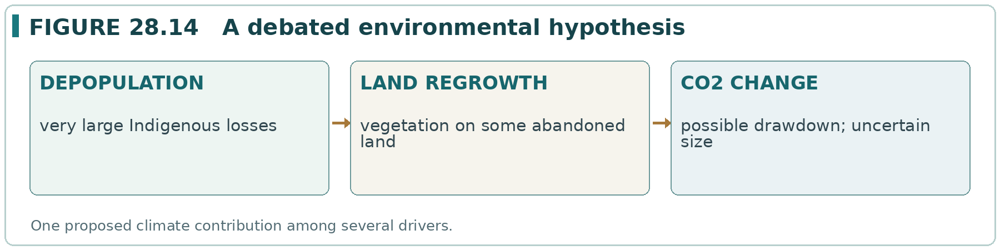

One provocative area of research examines whether the enormous population decline in the Americas helped affect the global environment. When agricultural land was abandoned in some regions, vegetation could regrow and draw carbon dioxide from the atmosphere. A 2019 modeling study proposed that this process contributed to a measurable atmospheric carbon-dioxide reduction associated with the early modern climate record. \[<a href="/028-the-columbian-exchange/sources/#source-19" class="cite">19</a>\]

This is not settled proof that Indigenous depopulation 'caused the Little Ice Age.' Climate variation has multiple drivers, including volcanic eruptions, solar variability, ocean-atmosphere dynamics and internal variability. The study's land-use and carbon estimates depend on uncertain demographic and ecological assumptions. Repeating its numbers without intervals would make an active research question appear more certain than it is.

The deeper significance is that people had already transformed American landscapes before colonization. Their farming, burning and land management affected vegetation. Loss of life could therefore have environmental consequences at scales detectable by later scientific methods. The past was an interaction of human and natural systems, not a stage on which only politics acted.

<figure class="figure" id="figure-28-14">

<figcaption>Figure 28.14. One proposed climate contribution among several drivers. <a class="figure-anchor" href="#figure-28-14" aria-label="Link to this figure">#</a></figcaption>
</figure>
