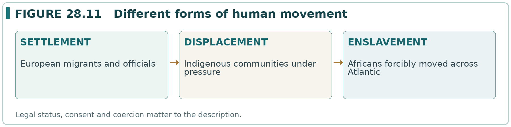

The exchange involved human movement as well as plants and microbes. European settlers, soldiers, clergy and merchants crossed the Atlantic. Africans were transported in growing numbers through coercive systems that expanded into a vast transatlantic slave trade. Indigenous Americans experienced forced displacement, migration, warfare and the reorganization of settlements. None of these movements can be captured by the word 'migration' alone.

The demographic disaster in many Indigenous regions was linked to rising demands for labor and land. Plantation owners and imperial officials drew upon enslaved Africans as the systems of sugar production, mining and colonial settlement expanded. Slavery predated Atlantic expansion in different parts of the world, but the Atlantic system became a distinct, large-scale regime of racialized hereditary bondage. Its full history is the subject of Chapter 29.

Human beings also moved knowledge. African farmers carried expertise in crops and irrigation; Indigenous specialists taught newcomers about American soils and medicines; European artisans brought techniques and institutions that were altered in colonial conditions. These interactions were unequal and frequently violent, but none of the populations involved were simply passive carriers of culture. \[<a href="/028-the-columbian-exchange/sources/#source-11" class="cite">11</a>\]\[<a href="/028-the-columbian-exchange/sources/#source-22" class="cite">22</a>\]

<figure class="figure" id="figure-28-11">

<figcaption>Figure 28.11. Legal status, consent and coercion matter to the description. <a class="figure-anchor" href="#figure-28-11" aria-label="Link to this figure">#</a></figcaption>
</figure>
