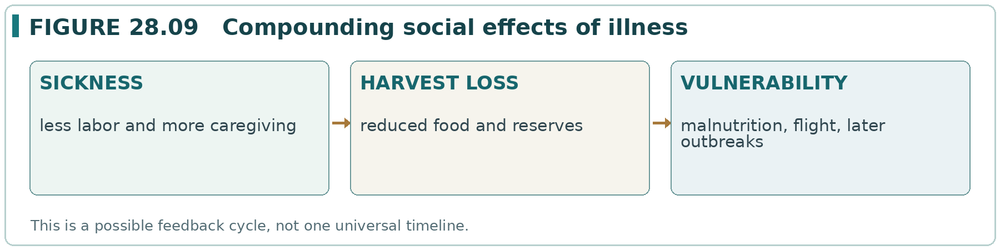

An epidemic kills and disables people, but its consequences go beyond an individual patient's illness. Imagine a farming district in which many adults become ill at planting time. Fields may go unsown; surviving relatives must care for children and the sick; food shortages can follow; trade and defense weaken. Subsequent outbreaks strike populations already stressed by scarcity and displacement. The effects can be cumulative rather than a one-time shock.

The loss of specialists—healers, elders, farmers, craftspeople, interpreters and political leaders—also threatens the transmission of knowledge. Some ceremonies and oral histories become harder to sustain when communities experience repeated loss. People nonetheless adapted, reorganized kinship ties, relocated, developed new institutions and maintained cultural practices. A history of epidemic catastrophe must preserve this survival and agency.

Epidemiological explanations do not absolve conquerors. Forced resettlement, labor drafts, violence, sexual exploitation and the destruction of food systems intensified vulnerability in many regions. Disease and coercion were entangled. To say 'disease caused the collapse' without asking about colonial policy risks hiding how human choices made outbreaks more deadly. \[<a href="/028-the-columbian-exchange/sources/#source-15" class="cite">15</a>\]\[<a href="/028-the-columbian-exchange/sources/#source-17" class="cite">17</a>\]

<figure class="figure" id="figure-28-9">

<figcaption>Figure 28.9. This is a possible feedback cycle, not one universal timeline. <a class="figure-anchor" href="#figure-28-9" aria-label="Link to this figure">#</a></figcaption>
</figure>
