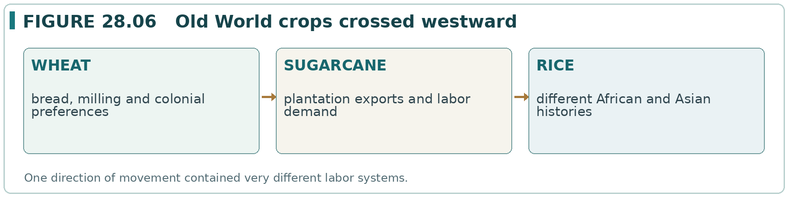

Old World crops crossed to the Americas as well. Wheat, barley, citrus, grapes, sugarcane and some rice varieties were planted in colonial settings, although adoption depended on climate and access to land. Wheat became associated in many Spanish colonial areas with European bread traditions and religious practices. These crops arrived among established Indigenous maize, bean, squash and root-crop systems rather than replacing them everywhere.

Sugarcane had moved through South and Southeast Asia and beyond long before 1492. Its cultivation in Atlantic islands helped develop models of intensive export production, capital investment and coerced labor that expanded into the Caribbean and Brazil. Sugar altered coastal landscapes through land clearance and water demand. Its output went to consumers across oceans, while severe labor costs were borne by people on plantations, including enslaved Africans. Chapter 29 examines Atlantic slavery more directly, but sugar's biological geography belongs here. \[<a href="/028-the-columbian-exchange/sources/#source-11" class="cite">11</a>\]\[<a href="/028-the-columbian-exchange/sources/#source-12" class="cite">12</a>\]

Rice tells a more complex story than 'Europeans introduced rice.' Asian rice and African rice were separately domesticated, and enslaved Africans transported both labor and agricultural expertise into parts of the Americas. Research continues into how particular rice traditions reached different colonial regions. Recognizing enslaved people's knowledge corrects accounts that reduce them to anonymous laborers.

<figure class="figure" id="figure-28-6">

<figcaption>Figure 28.6. One direction of movement contained very different labor systems. <a class="figure-anchor" href="#figure-28-6" aria-label="Link to this figure">#</a></figcaption>
</figure>
