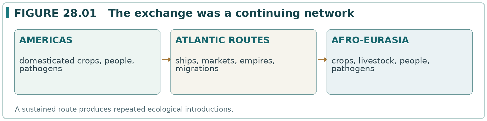

The historian Alfred W. Crosby popularized the term <em>Columbian Exchange</em> in a landmark 1972 study. It refers to the transfer of living organisms and their consequences between the Americas and Afro-Eurasia after 1492: crops, weeds, livestock, insects, pathogens and human populations, alongside technologies, ideas and habits. The name marks the beginning of an enduring Atlantic connection, not a claim that Columbus understood the world he had entered or created its civilizations. \[<a href="/028-the-columbian-exchange/sources/#source-1" class="cite">1</a>\]\[<a href="/028-the-columbian-exchange/sources/#source-3" class="cite">3</a>\]

Before 1492, the Atlantic separated two large biological worlds whose histories were not perfectly isolated. There had been earlier Norse contact with North America; Indigenous American societies had extensive trade routes and managed many environments; people had dispersed through the Pacific. But an enduring, high-volume transatlantic circuit of ships, settlers, provisions and cargo emerged only after Iberian voyages. What matters is sustained contact: one isolated ship can transport a seed; permanent networks repeatedly move plants, animals, people and disease.

The term itself requires care. An <em>exchange</em> may sound voluntary and balanced, but the processes were profoundly unequal. One species might cross through trade; another through theft or compulsory plantation labor; a pathogen might travel without anyone understanding its presence. The concept is useful precisely because organisms crossed political borders and altered life in ways neither rulers nor merchants entirely controlled.

<figure class="figure" id="figure-28-1">

<figcaption>Figure 28.1. A sustained route produces repeated ecological introductions. <a class="figure-anchor" href="#figure-28-1" aria-label="Link to this figure">#</a></figcaption>
</figure>
