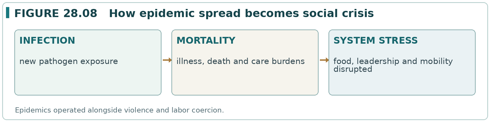

The most catastrophic consequences of sustained contact arose from epidemics. Smallpox, measles, influenza and other infections circulated among populations linked to Afro-Eurasian disease histories and spread into American communities with different histories of exposure. Many Indigenous populations faced waves of illness and mortality that undermined families, political institutions and food production. Deaths were not confined to moments when armies attacked. \[<a href="/028-the-columbian-exchange/sources/#source-14" class="cite">14</a>\]\[<a href="/028-the-columbian-exchange/sources/#source-15" class="cite">15</a>\]

A pathogen does not recognize a diplomatic agreement. It spreads through chains of human contact, sometimes traveling through Indigenous networks before a European expedition appears in a region. But historians must avoid asserting that every community suffered immediate epidemics after 1492; outbreak histories varied greatly and many first sustained exposures occurred later. Recent regional studies challenge broad assumptions about uniform timing. \[<a href="/028-the-columbian-exchange/sources/#source-16" class="cite">16</a>\]

The phrase 'no immunity' is too simple. Human immune defenses are complex; prior exposure, nutrition, genetic variation, pathogen characteristics and living conditions interact. Populations had immune systems and many infectious diseases before European arrival. What was often missing was acquired, pathogen-specific protection against particular newly introduced infections. This distinction matters scientifically and ethically.

<figure class="figure" id="figure-28-8">

<figcaption>Figure 28.8. Epidemics operated alongside violence and labor coercion. <a class="figure-anchor" href="#figure-28-8" aria-label="Link to this figure">#</a></figcaption>
</figure>
