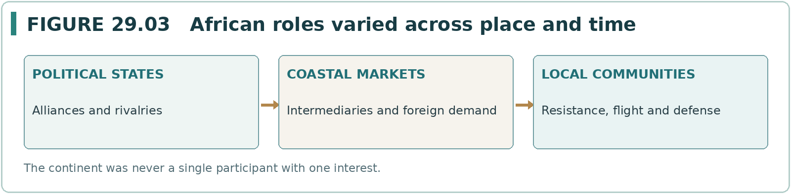

The Atlantic shoreline stretched past hundreds of societies with different languages, governments, economies and interests. Senegambian polities, Upper Guinea communities, the Gold Coast, the Bight of Benin, the Bight of Biafra, West Central Africa and parts of southeastern Africa entered the trade through different routes over four centuries. The principal regions supplying captives shifted over time; so did coastal commercial centers and overseas destinations.

Some African political leaders sought imported weapons, textiles, metals or other goods and became entangled in the sale of captives. Some fought rivals, seized prisoners or used legal and political processes that became corrupted by commercial demand. Other leaders resisted raids or attempted to regulate or reduce trade, while communities fled, fortified settlements, negotiated protection or sought refuge. Internal slavery and slave trading were real aspects of African history, but so were African opposition, survival strategies and flourishing political and cultural lives unrelated to the Atlantic system.

It is equally wrong to claim Europeans simply captured every person themselves or that Africans alone created the disaster. European buyers shaped demand, armed and rewarded trading partners, supplied maritime transport and underwrote colonial slave labor. Local power brokers mattered, but they operated inside changing coercive networks. Historical agency was widely distributed; responsibility must be analyzed rather than assigned to an imaginary unified continent.

<figure class="figure" id="figure-29-3">

<figcaption>Figure 29.3. The continent was never a single participant with one interest. <a class="figure-anchor" href="#figure-29-3" aria-label="Link to this figure">#</a></figcaption>
</figure>
