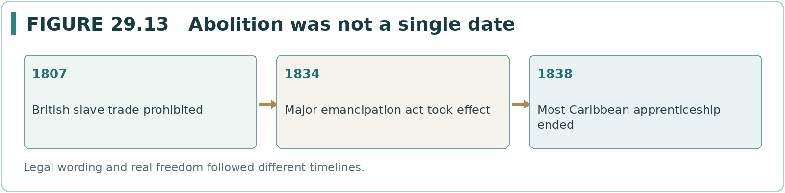

The campaign against Britain's slave trade developed through religious activism, Black testimony, petitions, boycotts, parliamentary debates and organizing networks. Olaudah Equiano's published narrative and the advocacy of formerly enslaved people helped make Atlantic violence visible to European audiences. Campaigners such as Thomas Clarkson and William Wilberforce were influential, but a history organized solely around them would obscure the central role of the enslaved and formerly enslaved, as well as resistance in the Caribbean that undermined slave systems.

Britain prohibited its slave trade in 1807, but that law did not abolish slavery in its colonies. The Slavery Abolition Act of 1833 took effect in 1834, followed by an apprenticeship system that continued compulsory labor in much of the British Caribbean until 1838. The state compensated slave owners to the amount of £20 million; the emancipated people were not awarded comparable compensation for generations of unpaid labor. These details expose the unequal distribution of political power even in a reform represented as humanitarian progress.

Abolition was a process of contested laws and enforcement. Merchants sought loopholes, reformers pressed for stronger measures, and freed people demanded fuller rights. An act printed in a statute book is a crucial historical turning point, but it is not identical to lived emancipation.

<figure class="figure" id="figure-29-13">

<figcaption>Figure 29.13. Legal wording and real freedom followed different timelines. <a class="figure-anchor" href="#figure-29-13" aria-label="Link to this figure">#</a></figcaption>
</figure>
