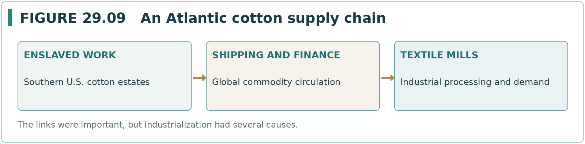

During the nineteenth century, cotton grown by enslaved workers in the southern United States supplied textile industries in Britain and elsewhere. Industrial spinning and weaving could increase demand for raw fiber; expanded cotton cultivation and forced labor could in turn supply factories. This did not mean slavery caused industrialization all by itself. Industrial growth had multiple sources—technological change, coal, institutions, domestic markets and international trade—but slavery was deeply connected to important industrial supply chains.

The demand for cotton encouraged plantation expansion across Indigenous lands, especially as United States policy enabled dispossession and settlement. Enslaved families were also broken apart through domestic trafficking from older slaveholding regions to newer cotton districts. Violence was institutional, not an accidental feature of a few unusually cruel owners.

Modern economic debates ask how much wealth from slavery financed particular industrial investments and whether claims about national development can be quantified. Scholars disagree about magnitudes and causal mechanisms. The secure point is more modest and significant: systems commonly narrated separately—American slavery, European textile factories, global finance and territorial expansion—interacted through commerce, politics and coercion.

<figure class="figure" id="figure-29-9">

<figcaption>Figure 29.9. The links were important, but industrialization had several causes. <a class="figure-anchor" href="#figure-29-9" aria-label="Link to this figure">#</a></figcaption>
</figure>
