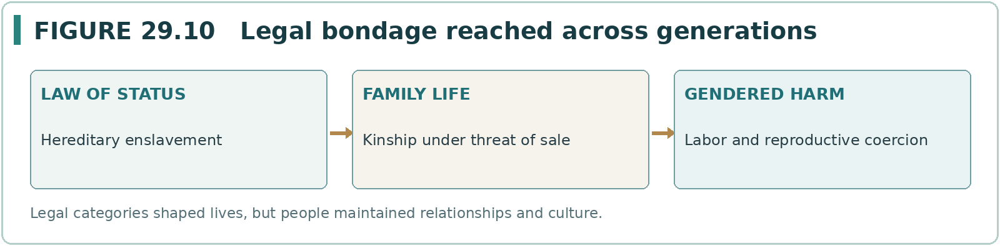

Enslaved women and men experienced common denials of liberty but often faced different forms of labor assignment and vulnerability. Women could work in fields, markets, kitchens, workshops or domestic service; they also faced sexual violence and reproductive coercion. Legal rules making enslaved status hereditary through mothers were integral to the growth of slaveholding populations in several colonies. Children were not protected from the institution's reach simply because they were born far from Atlantic ships.

Families formed and persisted despite conditions in which an owner could order relocation or sale. Religious practice, naming, storytelling, informal education, food cultivation and collective caregiving created social worlds beyond an owner's control. Oral traditions and later recollections offer crucial perspectives, although testimonies recorded after emancipation raise questions about memory, transcription and the influence of interviewers.

The existence of families and community did not soften slavery into an acceptable institution; it demonstrated human creativity under oppression. The question is not whether enslaved people possessed culture—that is obvious—but how they built and protected relationships inside structures designed to make them vulnerable.

<figure class="figure" id="figure-29-10">

<figcaption>Figure 29.10. Legal categories shaped lives, but people maintained relationships and culture. <a class="figure-anchor" href="#figure-29-10" aria-label="Link to this figure">#</a></figcaption>
</figure>
