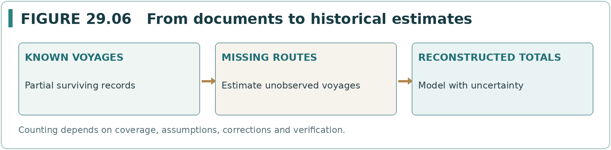

Historians use port registers, ship records, insurance documents, customs accounts, newspaper notices and scattered correspondence to reconstruct traffic across the Atlantic. The SlaveVoyages database permits analysis of individual known voyages and modeled estimates of the total. Researchers can examine embarkation regions, ship flags, landing ports, periods, sex and age distributions where data survive, and the consequences of missing observations.

Consider a simplified example, not an actual voyage record. Suppose a sample contains twenty documented ships averaging 280 people embarked, but archival evidence suggests twenty-five ships sailed. Multiplying 20 by 280 yields 5,600 documented embarkations. Estimating 25 × 280 suggests 7,000. The five unobserved voyages make a substantial difference; and if missing ships had systematically different sizes, even the second estimate could be biased. Historical quantification is therefore a model informed by evidence, not guesswork dressed up as precision.

A second warning concerns geography. A journey leaving from an African port may end in Brazil, the Caribbean or Spanish America; later sales may send the same person to another American destination. The first landing is not necessarily the final place of forced labor. The Atlantic slave trade and the intra-American slave trade are related but analytically distinct.

<figure class="figure" id="figure-29-6">

<figcaption>Figure 29.6. Counting depends on coverage, assumptions, corrections and verification. <a class="figure-anchor" href="#figure-29-6" aria-label="Link to this figure">#</a></figcaption>
</figure>
