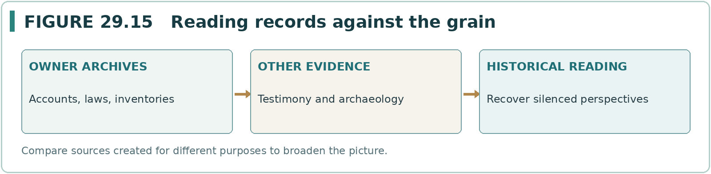

Our main source problem resembles the port ledger from the opening scene. Records created by slave traders, administrators and planters can be remarkably precise about prices, sales and shipping yet silent about personal experience. Historians read these materials 'against the grain': they ask what an owner's complaint reveals about resistance, what an advertisement for a runaway reveals about family ties or skills, and why a court record names a person only after conflict.

Testimonies by formerly enslaved people, oral histories, cemetery archaeology, material culture, language studies and religious traditions provide other routes to historical knowledge. Each source has limitations. An abolitionist pamphlet may use dramatic imagery to persuade; a later memoir may be shaped by time and publication; a shipping manifest may be incomplete; archaeological evidence may identify living conditions without an individual's name. Comparison produces stronger conclusions than treating one powerful source as exhaustive.

A particularly important distinction concerns documents and photographs. The famous diagram of the British slave ship Brooks or Brookes was used by abolitionists to expose cramped conditions, but it represents a particular visual argument and ship configuration, not every Atlantic voyage. Historical illustrations should be identified as sources with authors, dates and purposes rather than presented as photographic evidence.

<figure class="figure" id="figure-29-15">

<figcaption>Figure 29.15. Compare sources created for different purposes to broaden the picture. <a class="figure-anchor" href="#figure-29-15" aria-label="Link to this figure">#</a></figcaption>
</figure>
