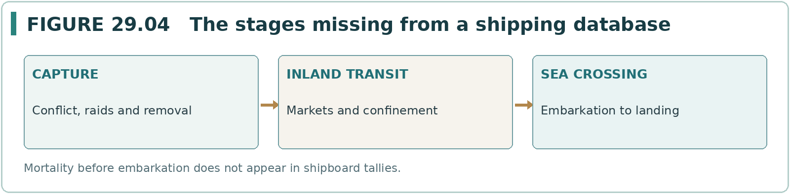

The Middle Passage began at sea, but for many captives suffering started long before a ship sailed. People could be marched in chains, confined in holding places, separated from relatives and exchanged through multiple commercial hands. Coastal forts such as Elmina or Cape Coast Castle became visible symbols of the trade, although not every captive passed through a stone fortress, and coastal histories differed substantially.

Mortality also occurred on routes from inland communities to the shore and in coastal detention. Because those deaths were rarely registered systematically, a voyage database cannot measure the entire demographic loss caused by slave trading. Nor can it easily count the additional people displaced by fear, fighting or the breakdown of agriculture. The record of people landed in an American port is therefore a lower boundary for many wider forms of suffering, not a complete human balance sheet.

For teaching purposes, imagine an evidentiary chain: a court testimony mentions capture, a merchant's account records an inland purchase, a fort ledger records delivery, a ship register records embarkation, and a plantation inventory records resale. Few actual individuals can be followed across every link. Reconstructing the chain requires comparing records that were created for different purposes and frequently used inconsistent names.

<figure class="figure" id="figure-29-4">

<figcaption>Figure 29.4. Mortality before embarkation does not appear in shipboard tallies. <a class="figure-anchor" href="#figure-29-4" aria-label="Link to this figure">#</a></figcaption>
</figure>
