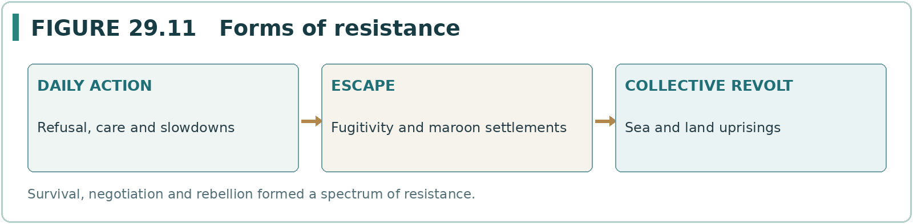

Resistance took many forms: escape attempts, work slowdowns, sabotage, preservation of forbidden practices, negotiation, the protection of kin and the pursuit of independent religious or social spaces. These actions differed in risk, scale and intention. Not every act of survival was an organized rebellion, but enslaved people repeatedly sought to widen the narrow sphere of choices allowed them.

Shipboard resistance occurred despite severe constraints. Captives could refuse food, attempt to seize vessels or coordinate revolts; crew records sometimes document these struggles while describing them from the perspective of slavers. On land, runaways formed communities in forests, mountains and border regions. Maroon societies survived for varying periods in Jamaica, Suriname, Brazil and other areas, negotiating, fighting or trading with surrounding states.

The archival visibility of resistance is uneven. Revolts generate dramatic records, but daily resistance may be recorded only as punishment or complaints. If we write the history exclusively through spectacular insurrections, we erase quieter, sustained struggles for autonomy; if we focus only on the quiet forms, we miss the political importance of collective rebellion.

<figure class="figure" id="figure-29-11">

<figcaption>Figure 29.11. Survival, negotiation and rebellion formed a spectrum of resistance. <a class="figure-anchor" href="#figure-29-11" aria-label="Link to this figure">#</a></figcaption>
</figure>
