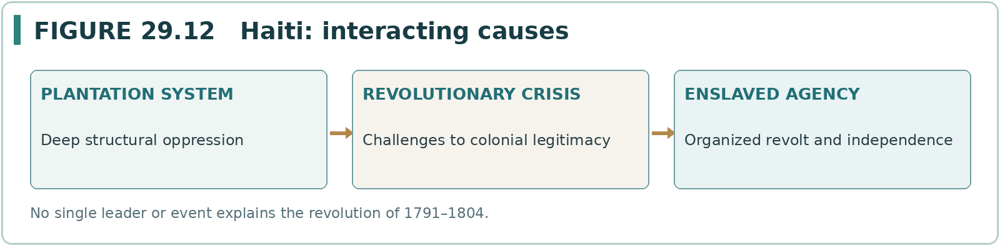

On the eve of the French Revolution, the French colony of Saint-Domingue was one of the Atlantic's richest sugar and coffee producers. Its wealth was built upon a large enslaved population subjected to severe exploitation. Social divisions included wealthy white planters, poorer whites, free people of color and enslaved people, but these categories concealed further inequalities and shifting alliances. The revolutionary language of liberty made the contradiction between universal rights and colonial slavery impossible to ignore.

An uprising of enslaved people began in 1791 amid wider conflict. Military and political struggles developed over more than a decade, involving colonial factions, French authorities, Spain, Britain and Black commanders. Toussaint Louverture emerged as a powerful leader but should not be treated as the revolution's sole architect. Jean-Jacques Dessalines, other leaders, soldiers, laborers and families also shaped the struggle. French abolition in 1794 was followed by Napoleon's attempt to reassert control; Haiti declared independence in 1804 following the defeat of the French expedition.

The Haitian Revolution demonstrated that enslaved people could overthrow a plantation regime and establish an independent state. Its consequences were international: it terrified slaveholders, inspired antislavery movements and altered imperial politics. Independence did not erase the devastation of war, diplomatic isolation or subsequent demands for financial indemnity. Haiti's achievement and subsequent constraints must be understood together.

<figure class="figure" id="figure-29-12">

<figcaption>Figure 29.12. No single leader or event explains the revolution of 1791–1804. <a class="figure-anchor" href="#figure-29-12" aria-label="Link to this figure">#</a></figcaption>
</figure>
