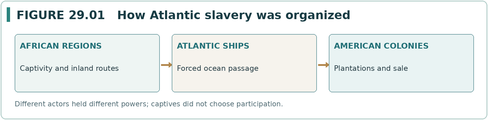

Slavery existed in many regions long before Europeans crossed the Atlantic. Captivity, household servitude, debt bondage, coerced labor and slave trading appeared in different African, European, Asian and American societies. These institutions were never identical. A person's ability to marry, acquire property, become free, pass status to children or be sold varied with time and place. Some systems allowed significant incorporation into families or political structures; others were hereditary and brutally extractive. The common element was a profound denial of freedom, but historians cannot explain institutions by saying simply that slavery had always existed.

The Atlantic system increasingly tied forced migration to enormous export-oriented plantations and to racialized, inheritable legal categories. In many colonies an enslaved woman's children inherited enslaved status, and owners acquired legally protected claims over labor and bodies. Laws specifying who could be enslaved were created and hardened through conflict; racial ideology helped justify what economic and political power made possible. It would be inaccurate to suggest that every earlier form of servitude was equivalent to nineteenth-century plantation slavery.

This distinction matters for responsibility. Earlier forms of bondage did not make Atlantic slavery inevitable, nor do they excuse its architects. European colonizers, merchants, financiers and legislators built and defended an interlocking system. African rulers and intermediaries sometimes supplied captives or contested the trade under varying pressures and incentives. Enslaved people were neither passive nor responsible for the coercion imposed upon them.

<figure class="figure" id="figure-29-1">

<figcaption>Figure 29.1. Different actors held different powers; captives did not choose participation. <a class="figure-anchor" href="#figure-29-1" aria-label="Link to this figure">#</a></figcaption>
</figure>
