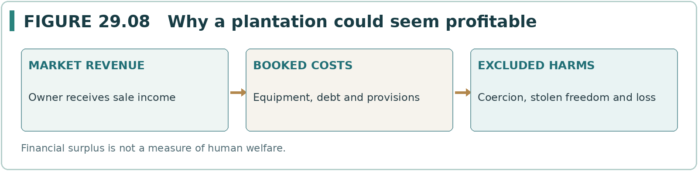

Sugar cultivation expanded in parts of Brazil and the Caribbean because climate and access to overseas markets made large-scale production attractive to investors. Establishing an estate could demand substantial capital for land, mills and equipment, and the operation required credit while a harvest grew. The development of plantation systems was therefore linked to banking, debt, shipping and long-term commercial relationships, not merely to local agricultural decisions.

Sugar plantations were violent workplaces. Labor in tropical heat, exhausting schedules and disease created serious health risks. Some plantation societies imported captives continuously rather than relying on population growth, reflecting high mortality, uneven sex ratios, poor nutrition and the constraints of forced labor. But there was variation across islands, decades and estates; one regional pattern must not become a universal rule.

The economic lesson is that a commodity's apparent market price depends on what is counted. A plantation's account book may show net revenue after paying for ships, machinery and enslaved people, but it does not reflect the stolen freedom or suffering of those forced to work. A high-profit system can be socially catastrophic precisely because it transfers costs onto people denied legal power.

<figure class="figure" id="figure-29-8">

<figcaption>Figure 29.8. Financial surplus is not a measure of human welfare. <a class="figure-anchor" href="#figure-29-8" aria-label="Link to this figure">#</a></figcaption>
</figure>
