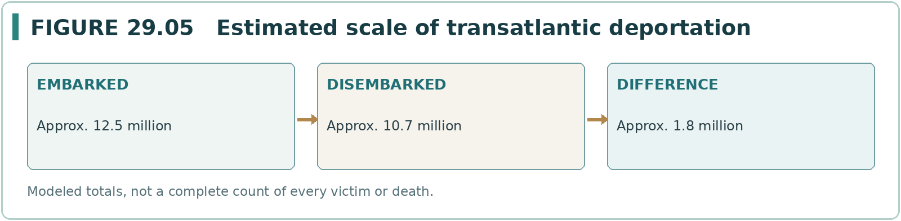

The forced Atlantic crossing was known as the Middle Passage because it formed one stage of a larger trading route. Captives were transported below decks in cramped, unsanitary conditions; violence and coercion enforced confinement. Disease, dehydration, starvation, injury and despair contributed to mortality. Conditions varied by ship, decade, voyage length, provisioning and resistance, but variation does not diminish the system's inherent violence. Survivors faced sale and enslavement on arrival rather than freedom at the end of the journey.

Research organized through the SlaveVoyages project estimates that roughly 12.5 million enslaved Africans were embarked on transatlantic ships, with about 10.7 million disembarking. The difference is approximately 1.8 million people, but it should not be interpreted as a complete count of all deaths: categories include uncertainties and the figures do not encompass mortality before embarkation, nor all later loss of life. The data combine documented voyages with estimates for missing voyages; these are historical reconstructions rather than a single perfectly complete passenger list.

When a general book quotes a death percentage, it must say what is measured. Deaths between recorded embarkation and recorded disembarkation are not the same as deaths from capture to plantation, and a rate averaged over centuries hides tremendous variation. A humanitarian tragedy cannot be reduced to a statistic, but accurate statistics help correct fantasies about its scale.

<figure class="figure" id="figure-29-5">

<figcaption>Figure 29.5. Modeled totals, not a complete count of every victim or death. <a class="figure-anchor" href="#figure-29-5" aria-label="Link to this figure">#</a></figcaption>
</figure>
