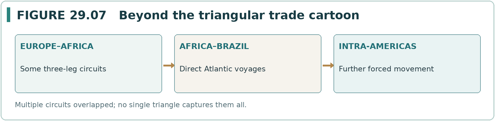

Many schoolbooks illustrate a triangular trade: European manufactured goods go to Africa, enslaved Africans cross to the Americas, and plantation commodities move to Europe. Some circuits broadly followed this pattern, and the diagram helps explain exchange among regions. Yet it does not describe every voyage. Ships could sail directly between Brazil and Angola, move between Caribbean islands, return with different cargoes, or operate within regional networks. American merchants and investors helped sustain the trade.

The simplified triangle can also conceal the most important asymmetry. Cloth, metalware, sugar and coffee were exchanged through commercial processes; human beings were captured, sold and forcibly transported. The movement of coerced people is not ethically or analytically equivalent to merchandise moving between markets. It is important to identify who made decisions and who was denied the ability to refuse.

For a richer picture, imagine several overlapping networks: ocean transportation, insurance and credit, colonial political authority, inland captive routes, plantation output and consumer demand. Money and information returned across the network. The Atlantic economy was not one neat itinerary but a system in which many actors made decisions at different scales.

<figure class="figure" id="figure-29-7">

<figcaption>Figure 29.7. Multiple circuits overlapped; no single triangle captures them all. <a class="figure-anchor" href="#figure-29-7" aria-label="Link to this figure">#</a></figcaption>
</figure>
