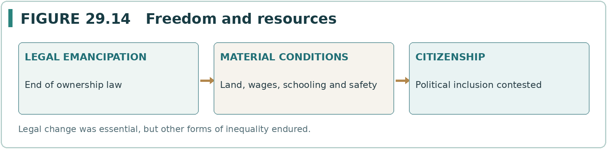

Formal emancipation ended the legal right of one person to own another, a profound transformation. It enabled new claims to marriage, family security, movement, schooling, religion and political recognition. Formerly enslaved people built churches, mutual-aid associations, schools and communities; they negotiated wages and land access and pursued their own visions of freedom. Yet the distribution of property was rarely transformed as radically as the end of legal ownership might suggest.

Many former slaveholders retained land, political influence and credit. Formerly enslaved workers often faced exploitative contracts, sharecropping, discriminatory laws or violence. In the United States, the era of Reconstruction opened important political opportunities but was followed by disenfranchisement, segregation and racial terror. In Caribbean and South American societies, emancipation likewise did not guarantee equal access to education, land or political participation.

This contrast helps distinguish legal freedom from practical capability. A person may be legally free to leave an employer while lacking money, land, safe housing or other realistic work. Those material conditions do not erase the revolutionary significance of emancipation, but they are necessary to explain its limits and the long duration of struggles for equality.

<figure class="figure" id="figure-29-14">

<figcaption>Figure 29.14. Legal change was essential, but other forms of inequality endured. <a class="figure-anchor" href="#figure-29-14" aria-label="Link to this figure">#</a></figcaption>
</figure>
