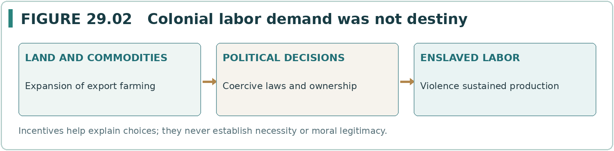

After 1492, European conquest and settlement created demand for labor in American colonies. Sugar plantations, mines, tobacco fields and later coffee and cotton estates all required workers under difficult conditions. Colonizers seized Indigenous land, imposed forced labor on Indigenous communities and reorganized local economies. Disease, warfare, displacement and resistance to coercion changed labor regimes, but these changes did not make African enslavement the only conceivable option. Colonial authorities selected among labor systems within structures that rewarded low-cost, controllable labor and long-distance exports.

Sugar offers a powerful example. Its cultivation and processing required land, equipment, mills, transport and demanding labor schedules. Sugar was grown elsewhere before Atlantic colonization, including Mediterranean and Atlantic island sites, so American plantations drew upon older techniques and practices. But the rapid growth of colonial plantations created a commercial demand for enslaved labor on a scale not previously seen in the region. European consumers wanted sweet products; state officials wanted customs revenue; merchants sought returns; planters wanted control over workers. The result was not a single conspiracy but a chain of decisions sustained by violence.

By the seventeenth and eighteenth centuries, Atlantic shipping linked African capture regions, coastal markets, American plantations, European industries and consumers. To describe this as a market does not imply willing participation by everyone inside it. People were forcibly turned into commodities while many other participants pursued profits or political advantage.

<figure class="figure" id="figure-29-2">

<figcaption>Figure 29.2. Incentives help explain choices; they never establish necessity or moral legitimacy. <a class="figure-anchor" href="#figure-29-2" aria-label="Link to this figure">#</a></figcaption>
</figure>
