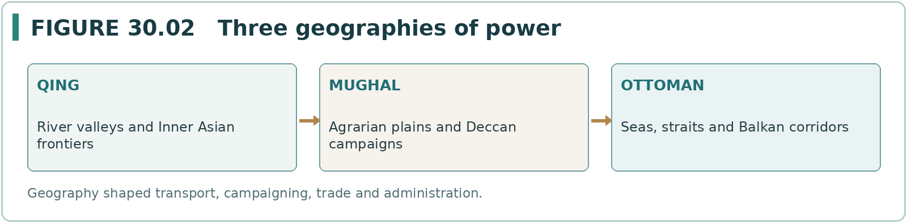

The Qing operated across agricultural plains, river valleys, forests, deserts, oases and high-altitude frontiers. Grain and taxes in heavily populated regions supported imperial administration and garrisons elsewhere. Rivers and canals connected production to cities, while Inner Asian diplomacy and war involved horses, pasture, caravan routes and frontier forts. The empire was continental as well as Chinese, and its rulers managed different communities through different institutions.

The Mughal heartlands included the Indo-Gangetic plains, Punjab, rich commercial cities and irrigated zones, with expansion into the Deccan and other regions requiring sustained campaigns and bargaining. Its economy was deeply connected to Indian Ocean commerce, yet much of the imperial tax base came from agriculture. Monsoon patterns mattered to seaborne merchants; monsoons, rivers and harvest cycles mattered equally to administrators collecting land revenue.

The Ottomans occupied a strategic crossroads: Black Sea access, the Bosporus, the Aegean, eastern Mediterranean ports, Danubian corridors, Anatolian routes, the Nile valley, Syria, Iraq and pilgrimage routes toward the holy cities. Mountain ranges, islands and contested borders made centralized control costly. Imperial strength came partly from keeping different regional systems connected without insisting that every district operate identically. Geographical diversity was a source of resources and a permanent governing problem.

<figure class="figure" id="figure-30-2">

<figcaption>Figure 30.2. Geography shaped transport, campaigning, trade and administration. <a class="figure-anchor" href="#figure-30-2" aria-label="Link to this figure">#</a></figcaption>
</figure>
