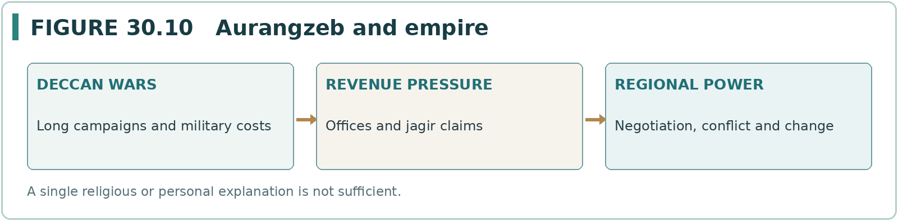

Aurangzeb (reigned 1658–1707) came to power through a violent struggle for succession and presided over both wide imperial territorial reach and growing strains. His reign is debated fiercely, often because later nationalist or communal narratives reduce complex policies to a single judgement about religious tolerance or persecution. The evidence records policies that disadvantaged certain communities, including the reimposition of jizya in 1679, and episodes of temple destruction connected with political circumstances. It also records continuing service by many Hindu elites in imperial institutions and varied local arrangements.

Long wars in the Deccan against rival powers, including Maratha resistance, demanded money, soldiers and attention. Expansion on a map could weaken the ability to govern efficiently. Military victories did not guarantee that new territories would supply dependable revenue, and the imperial system increasingly struggled with pressures surrounding offices, jagirs and regional leaders.

Neither the claim that Aurangzeb personally 'destroyed' a completely healthy empire nor the claim that his reign was merely a seamless period of success adequately describes the evidence. Structural fiscal and military problems, regional identities, shifting alliances, succession struggles and changing commercial relations all mattered. A useful question is not whether he was a hero or villain, but which decisions and conditions made durable imperial rule increasingly difficult.

<figure class="figure" id="figure-30-10">

<figcaption>Figure 30.10. A single religious or personal explanation is not sufficient. <a class="figure-anchor" href="#figure-30-10" aria-label="Link to this figure">#</a></figcaption>
</figure>
