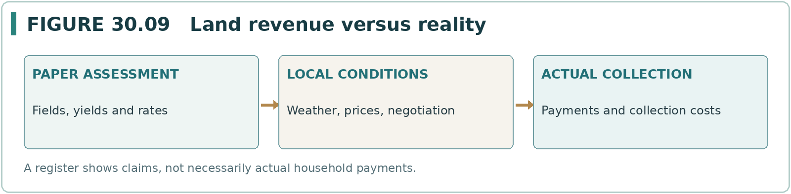

Most imperial resources ultimately came from agricultural production. The state needed to know what land could yield, how harvests varied and which communities would pay. Under Akbar, fiscal officials associated with Raja Todar Mal developed measures and arrangements often described through the zabt or dahsala revenue systems in portions of northern India. Techniques involved measurement, valuation, classification and assessment, but there was no single revenue mechanism used identically across every district.

A farming household experienced revenue policy as an obligation expressed in grain, cash, labor or negotiation, depending on location and circumstances. Collectors could face crop failure; villagers could face demands that failed to adjust adequately to local difficulty. Zamindars might mediate payments, maintain armed followings or claim their own rights. An imperial paper assessment was not the same as revenue actually collected after weather, evasion, conflict and administrative costs.

The Mughal economy was not merely a mechanism for extracting grain. Cultivators produced food and commercial crops, artisans manufactured textiles, merchants moved goods and credit, and cities supported dense markets. Nevertheless, the greatest honors at court ultimately rested on agricultural surplus. Comparing irrigation, assessment and grain movement teaches us more about daily imperial capacity than a list of battles alone.

<figure class="figure" id="figure-30-9">

<figcaption>Figure 30.9. A register shows claims, not necessarily actual household payments. <a class="figure-anchor" href="#figure-30-9" aria-label="Link to this figure">#</a></figcaption>
</figure>
