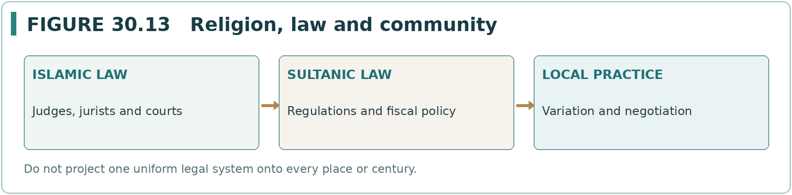

Ottoman governance combined Islamic jurisprudence, legal scholars and courts with sultanic regulations often called kanun. Judges, or kadis, handled disputes and recorded transactions, while religious authorities interpreted law. Not everyone experienced the same rules. Gender, legal status, locality and community affiliation affected rights and practical outcomes. Court registers can preserve details of ordinary disputes over marriage, debts, inheritance and property, although access to justice was unequal.

Muslim and non-Muslim subjects lived across the empire. Orthodox Christians, Armenian Christians, Jews and other groups maintained institutions, negotiated with authorities and paid taxes whose form and incidence changed with time and place. The term millet is often used to describe communal organization, but the tidy picture of a fixed, fully developed 'millet system' operating everywhere from 1453 is anachronistic. Later formal categories should not be automatically projected onto the sixteenth century.

Religious accommodation coexisted with hierarchy and discrimination. Some minority communities could administer aspects of communal life and sustain commercial networks; they did not possess modern equal citizenship. Conflicts, forced conversions, restrictions and local violence also occurred. Asking whether the empire was 'tolerant' gives only a partial answer. Ask instead: compared with what, in which period, for whom, and under which law?

<figure class="figure" id="figure-30-13">

<figcaption>Figure 30.13. Do not project one uniform legal system onto every place or century. <a class="figure-anchor" href="#figure-30-13" aria-label="Link to this figure">#</a></figcaption>
</figure>
