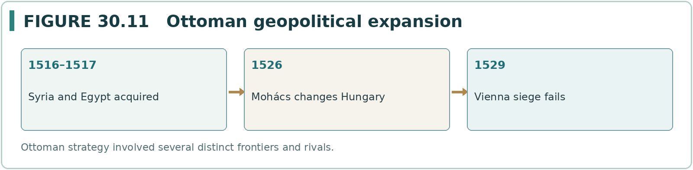

By the start of the sixteenth century, the Ottoman dynasty had ruled for generations. The conquest of Constantinople in 1453 had made Istanbul an imperial center. Selim I's campaigns in 1516–1517 defeated the Mamluk Sultanate and brought Syria and Egypt under Ottoman control, with far-reaching consequences for the eastern Mediterranean, Red Sea and Islamic holy cities. Control varied by region, but this transformation gave Ottoman rulers new sources of legitimacy, revenue and strategic responsibility.

Süleyman I (reigned 1520–1566), known in different traditions as 'the Magnificent' or 'the Lawgiver,' expanded Ottoman reach. The Battle of Mohács in 1526 shattered the medieval Hungarian kingdom and transformed Danubian politics. Ottoman forces besieged Vienna in 1529 without capturing it; conflicts with Habsburg rulers continued. In Iraq and eastern Anatolia, rivalry with Safavid Iran shaped military and confessional policy. Expansion also involved naval warfare and diplomacy across the Mediterranean.

These campaigns did not leave behind a uniformly administered empire. Some territories were governed directly; others paid tribute, retained dynasties or negotiated forms of dependence. Ottoman victories must be situated within European, Iranian, Arab and North African political worlds rather than presented as isolated acts of one ruler.

<figure class="figure" id="figure-30-11">

<figcaption>Figure 30.11. Ottoman strategy involved several distinct frontiers and rivals. <a class="figure-anchor" href="#figure-30-11" aria-label="Link to this figure">#</a></figcaption>
</figure>
