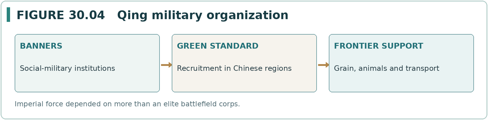

The Manchus emerged from the northeastern frontier under the leadership of Nurhaci and his successors. Institutions later known as the Eight Banners organized people into military and social communities with obligations and privileges; they were not merely eight groups of battlefield flags. Banner membership incorporated Manchus, Mongols and Han Chinese, and was reshaped by conquest. The banner system helped sustain a dynastic identity even when Qing rulers adopted many forms of Chinese government.

Hong Taiji formalized the Qing dynastic name in 1636. In 1644, Dorgon and associated forces entered Beijing amid the Ming crisis, placing the young Shunzhi emperor at the center of a new imperial order. The Qing then expanded and fought regional claimants, including southern Ming loyalists. Its military also employed the Green Standard Army, many of whose soldiers were recruited from former Ming troops and Chinese communities. An empire of this scale could not be held by banner forces alone.

The conquest included destruction, requisition, and policies such as the queue order, which became a visible symbol of submission and a cause of resistance. A retrospective image of a harmonious 'dynastic transition' can obscure the lives lost and the difficult decades of consolidation. The new rulers built legitimacy through ritual and administration, but coercion was fundamental to the founding process.

<figure class="figure" id="figure-30-4">

<figcaption>Figure 30.4. Imperial force depended on more than an elite battlefield corps. <a class="figure-anchor" href="#figure-30-4" aria-label="Link to this figure">#</a></figcaption>
</figure>
