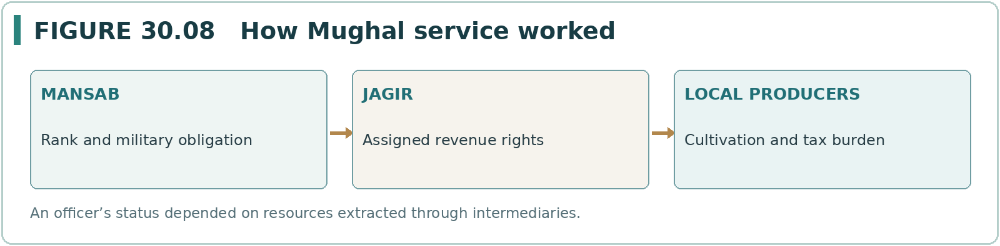

The Mughal mansabdari system assigned ranks to imperial officers, expressed through numbers associated with personal status and military obligations. Terms such as zat and sawar became important in defining standing and the cavalry service expected from an officer. The system was not a perfectly consistent formula throughout its history, and the ratio between nominal ranks and forces present on campaign could differ. Nevertheless, it supplied a language for the court to organize its servants.

Many holders were compensated through assignments of land revenue, often called jagirs, rather than permanent private ownership of land. A jagirdar was typically assigned rights to collect specified revenues from a district to support his position and service. Such assignments could be transferred. Local proprietors, village communities and zamindars—whose roles differed by region—continued to possess claims and influence. The empire relied on intermediaries, not a direct line from the emperor to each cultivator.

The arrangement created flexibility and danger. An emperor could move officers and prevent some permanent concentrations of power. But officers competing for adequate assignments could press heavily on revenue-paying communities, while distant officials might misrepresent resources. If too many ranks were awarded in relation to collectable income, conflict intensified. Do not imagine a static feudal system: Mughal ranking, cash payments, land revenue rights and local politics changed together over time.

<figure class="figure" id="figure-30-8">

<figcaption>Figure 30.8. An officer’s status depended on resources extracted through intermediaries. <a class="figure-anchor" href="#figure-30-8" aria-label="Link to this figure">#</a></figcaption>
</figure>
