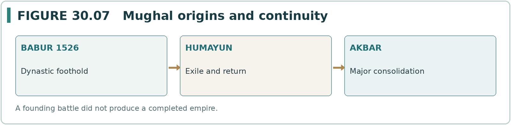

The Mughal dynasty arose from a Central Asian princely world shaped by Timurid and Chinggisid political legacies. Babur, a Timurid ruler, defeated Ibrahim Lodi at the First Battle of Panipat in 1526 and established a new dynastic foothold in North India. The victory did not mean instant control of the entire subcontinent. Babur faced opposition, and his successors had to consolidate uncertain territorial and political claims.

Humayun lost power to the Afghan Sur dynasty, associated with Sher Shah Suri, and spent time in exile, including at the Safavid court in Iran. He recovered Delhi in 1555 but died the following year. The interlude is useful because it reminds us that a victorious founder does not automatically build a durable state. Sher Shah's administration, currency and road policies also had lasting significance and influenced later practice.

The term 'Mughal,' derived through Persian usage from 'Mongol,' should not make us picture a thirteenth-century Mongol army transplanted unchanged to India. The dynasty's governing culture was Persianate, its military and aristocracy varied over time, and its legitimacy evolved through marriage, alliance, court rituals and administrative success. The empire was Indian in its everyday social foundations even while the ruling house remembered Central Asian ancestry.

<figure class="figure" id="figure-30-7">

<figcaption>Figure 30.7. A founding battle did not produce a completed empire. <a class="figure-anchor" href="#figure-30-7" aria-label="Link to this figure">#</a></figcaption>
</figure>
