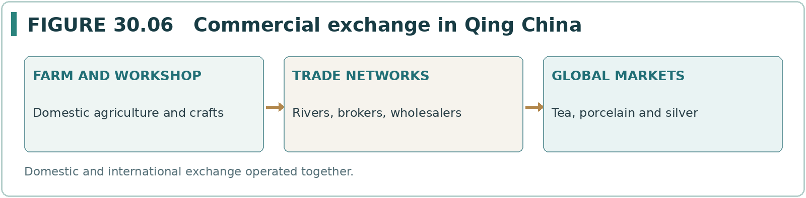

Agriculture supported most households. Rice cultivation, wheat and other grains, regional cash crops, and complex transport and irrigation arrangements produced goods for local and wider markets. Commercial networks connected highly productive regions such as the lower Yangzi with towns across the empire. Population growth and shifting settlement patterns changed demands on land, fuel, water and labor. Expansion of markets should not be confused with equal prosperity for all producers.

Chinese silk, tea and porcelain circulated widely. Porcelain was made within sophisticated systems of labor, specialization, government orders and private trade. European demand mattered, but Asian consumers and domestic markets were substantial; China did not exist merely to furnish European shelves. The movement of silver reflected multiple networks and incentives, including exports and tax payments. It is inaccurate to claim that one shipment of American silver simply 'funded' the entire empire.

The Canton trade system restricted the channels through which many Western merchants operated in the later eighteenth century. Foreign participation was regulated rather than entirely absent. Chinese merchants, commercial firms and officials possessed bargaining power. Yet this arrangement would later become a flashpoint as British and other imperial interests sought different terms. Those nineteenth-century conflicts should not be read backward as proof of Qing weakness in 1700.

<figure class="figure" id="figure-30-6">

<figcaption>Figure 30.6. Domestic and international exchange operated together. <a class="figure-anchor" href="#figure-30-6" aria-label="Link to this figure">#</a></figcaption>
</figure>
