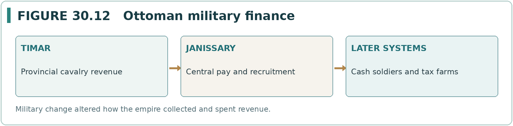

Ottoman military organization changed substantially over time. The timar system allocated rights to revenues from particular lands to cavalrymen, known as sipahis, in return for service; it did not simply grant them absolute private ownership over all peasants and fields. State surveys and tax registers, the tahrir defters, helped specify claims in some provinces. Other regions used different fiscal and military arrangements.

The janissaries developed as an elite infantry force associated with the sultan's household and paid by the central treasury. Recruitment historically included the devshirme, the levy of boys from certain Christian communities who were converted to Islam and trained for imperial service. The process was coercive even when it created paths to office for some individuals. Over time recruitment, membership, privileges and political influence changed greatly; the corps should not be treated as a timeless, unchanging instrument.

Siege artillery and firearms contributed to Ottoman victories, but neither rendered fortification, finance or diplomacy obsolete. By the seventeenth century the empire used additional salaried soldiers and military labor markets as warfare changed. The growth of cash expenses encouraged fiscal adaptation. A strong military system is therefore a relationship among technology, people, revenue and political authority, not an inventory of cannons.

<figure class="figure" id="figure-30-12">

<figcaption>Figure 30.12. Military change altered how the empire collected and spent revenue. <a class="figure-anchor" href="#figure-30-12" aria-label="Link to this figure">#</a></figcaption>
</figure>
