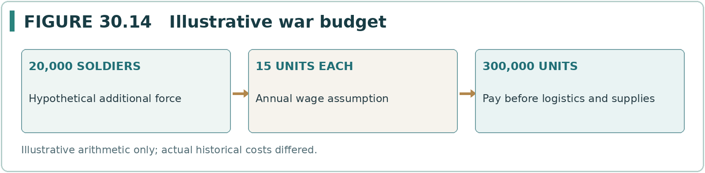

Each empire faced armed rivals. Qing frontier campaigns demanded animals, grain, cash and transport across extraordinary distances. Mughal campaigns in the Deccan tied up forces and worsened pressures on revenue assignments. The Ottomans fought costly wars against Habsburg, Safavid, Russian and other opponents while managing naval commitments. An army might win a battle yet leave the treasury exposed or a province exhausted.

Imagine a hypothetical administrative calculation: a ruler recruits an additional 20,000 soldiers at an average annual cash cost of 15 monetary units each. Wages alone equal 300,000 units, before equipment, food, transport and garrison construction. This is a teaching calculation, not a reconstruction of any one army. If a province yields 500,000 units in tax revenue, the paper surplus may evaporate after collection costs, local obligations and a failed harvest. Military reach depends upon fiscal capacity, and fiscal extraction can damage the production on which that capacity rests.

The core mechanism is feedback. Warfare leads to higher expenditure; raising revenue can provoke resistance or hardship; unrest requires further military spending. Effective reforms can break the cycle, while poor information or weak institutions can deepen it. This model cannot substitute for the specific facts of each empire, but it gives readers a question to bring to every campaign narrative: who supplied the food, horses, wages and credit?

<figure class="figure" id="figure-30-14">

<figcaption>Figure 30.14. Illustrative arithmetic only; actual historical costs differed. <a class="figure-anchor" href="#figure-30-14" aria-label="Link to this figure">#</a></figcaption>
</figure>
