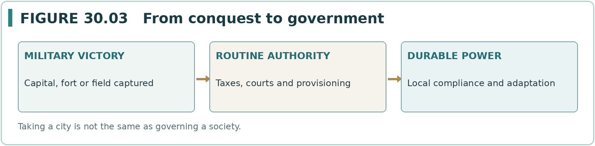

Conquest could transfer a palace, army or tax office to a new dynasty. Durable rule required convincing or compelling other people to perform routine work: assess fields, measure grain, settle lawsuits, maintain roads, supply horses, register households and manage local disputes. Each empire inherited established institutions and repurposed them. The Qing retained many Ming civil institutions alongside a distinct Manchu military-political establishment. The Mughals incorporated Persianate administrative traditions and regional Indian practices. The Ottomans combined dynastic authority with Islamic jurisprudence, sultanic legislation and local arrangements.

The work of an empire was therefore collective and often contentious. A provincial governor could obstruct policy; merchants could move capital; soldiers could mutiny; peasants could flee oppressive tax demands. Imperial policy appeared in proclamations, but historians assess implementation through account books, lawsuits, petitions, correspondence, architecture and local evidence. The formal diagram of a state often hides the bargaining that made it function.

Power could also bring protection, new markets, patronage and infrastructure, while imposing warfare, unequal privilege and coercion. An explanation of administrative success should never be mistaken for blanket approval. Good history asks who experienced stability, who paid its costs, and when the balance changed.

<figure class="figure" id="figure-30-3">

<figcaption>Figure 30.3. Taking a city is not the same as governing a society. <a class="figure-anchor" href="#figure-30-3" aria-label="Link to this figure">#</a></figcaption>
</figure>
