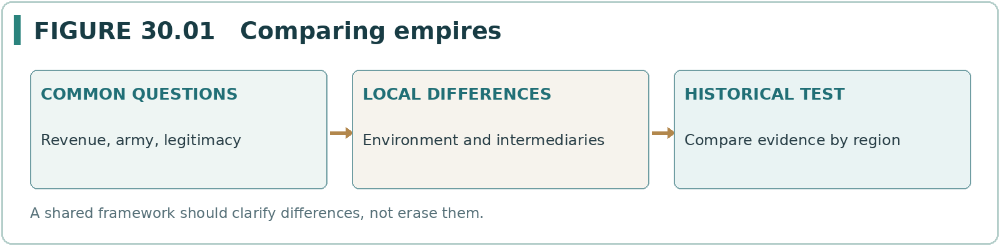

A comparison can reveal structures hidden by individual narratives. Ask the same questions of each empire. Where did revenue come from? Who governed villages? Which armies were paid in cash, land revenue or hereditary allowances? How did rulers portray themselves to people of different religions and languages? What happened when local elites withheld cooperation? Which regions remained outside firm imperial control? These common questions allow explanations stronger than a parade of emperor names.

But the three territories were not equivalent boxes on a map. Qing sovereignty over Mongolian steppe communities did not function like routine civil administration in the lower Yangzi valley. Mughal claims to a district might survive even while a regional prince controlled its resources. The Ottomans had different arrangements for core Anatolian districts, Arab provinces, autonomous tributaries and frontier zones. A color-filled atlas map offers a starting point, not an administrative audit.

Older scholarship sometimes grouped the Mughals, Ottomans and Safavids as 'gunpowder empires.' Firearms and siege artillery mattered, and the Safavid dynasty in Iran remains indispensable to the story. Yet the label can make technological advantage look like the main cause of power. Revenue systems, cavalry, irrigation, alliances, family politics, religion, trade, and the ability to adapt institutions were equally important. The Qing arose in a later setting and should not simply be squeezed into the same technological category. Use labels as tools, not explanations in themselves.

<figure class="figure" id="figure-30-1">

<figcaption>Figure 30.1. A shared framework should clarify differences, not erase them. <a class="figure-anchor" href="#figure-30-1" aria-label="Link to this figure">#</a></figcaption>
</figure>
