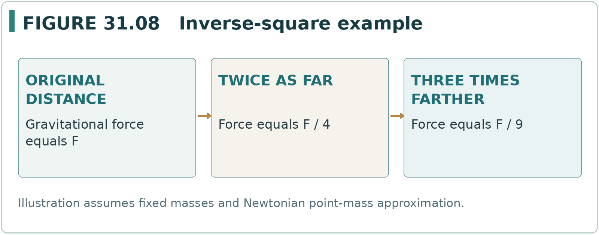

Consider an invented classroom example of an orbital object whose distance from a central mass doubles while other simplifying conditions hold. Newton's inverse-square relation implies that the gravitational force at the greater distance is one fourth of the original force. Tripling the distance would reduce it to one ninth. The calculation is simple, but its implication is substantial: a compact rule applies to an enormous range of possible cases.

What the rule does <em>not</em> tell you by itself is the object's whole orbit. You also need its initial velocity, masses, and the influence of other bodies. An object can be attracted strongly toward a planet and still miss its surface if it has sufficient sideways motion. A true orbital explanation combines force with movement rather than picturing planets somehow balanced motionless against attraction.

There is an important epistemic habit here. Use mathematics to make a claim more exact, but do not let an elegant formula hide its assumptions. The inverse-square statement works for Newtonian gravitation under relevant approximations. A number is informative when we can explain where it comes from and which questions it actually answers.

<figure class="figure" id="figure-31-8">

<figcaption>Figure 31.8. Illustration assumes fixed masses and Newtonian point-mass approximation. <a class="figure-anchor" href="#figure-31-8" aria-label="Link to this figure">#</a></figcaption>
</figure>
