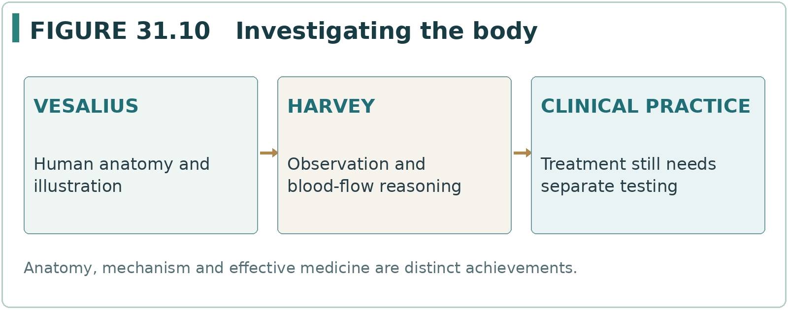

Andreas Vesalius's <em>De humani corporis fabrica</em> appeared in 1543, the same year as Copernicus's major work. Vesalius emphasized direct investigation of human anatomy and challenged some teachings associated with Galen, whose accounts partly reflected animal dissections. Anatomical knowledge grew through dissections, illustration, surgery, and controversy over religious and moral boundaries. This was a practical and often ethically difficult enterprise, not simply a triumph of illustration over books.

William Harvey's <em>De motu cordis</em> (1628) argued that blood circulates through the body under the pumping action of the heart. His reasoning involved anatomical observation, experiments on animals, and estimation of blood flow. The quantitative point mattered: the volume of blood that would have to be continually produced under some older assumptions seemed implausibly large. By considering a system, Harvey developed a more persuasive account of circulation.

Medical progress remained uneven. Physicians continued to rely on interventions whose effectiveness was uncertain, and explanations of contagious disease were incomplete. The rise of better anatomy did not transform public health overnight. Knowledge of structure, knowledge of cause, and ability to treat patients are related but distinct achievements.

<figure class="figure" id="figure-31-10">

<figcaption>Figure 31.10. Anatomy, mechanism and effective medicine are distinct achievements. <a class="figure-anchor" href="#figure-31-10" aria-label="Link to this figure">#</a></figcaption>
</figure>
