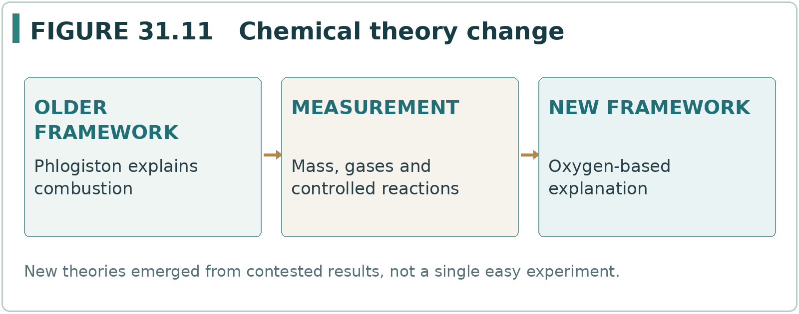

Seventeenth- and eighteenth-century chemistry emerged from traditions of medicine, mining, metallurgy, dyeing, distilling, and alchemy. Investigators used furnaces, retorts, glass vessels, balances, and practical knowledge built in workshops. Robert Boyle's <em>The Sceptical Chymist</em> (1661) questioned inherited definitions of elements, though later chemistry would not simply implement his own full system.

During the eighteenth century, chemists debated combustion and 'phlogiston,' a proposed principle associated with burning materials. Joseph Priestley and Carl Wilhelm Scheele obtained gases that would later be understood as oxygen, while Antoine-Laurent Lavoisier and collaborators developed a different explanatory framework based on combustion involving oxygen and precise measurements of mass. Lavoisier's <em>Elementary Treatise of Chemistry</em> appeared in 1789 and helped reform chemical nomenclature.

This was not a simple confrontation between irrational believers and a single hero. Older theories could organize experiments fruitfully, while new theories initially had their own unresolved problems. Even Lavoisier accepted hypotheses later discarded. Scientific improvement becomes easier to understand when we compare predictions, experiments, measurement practices, and the ability of rival frameworks to explain troublesome results.

<figure class="figure" id="figure-31-11">

<figcaption>Figure 31.11. New theories emerged from contested results, not a single easy experiment. <a class="figure-anchor" href="#figure-31-11" aria-label="Link to this figure">#</a></figcaption>
</figure>
