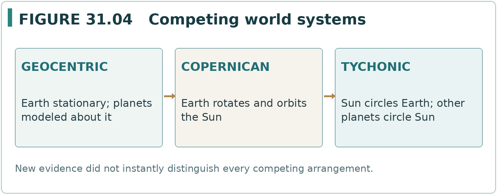

In 1543 Nicolaus Copernicus published <em>De revolutionibus orbium coelestium</em>. He proposed a mathematical arrangement in which Earth rotates daily and, with other planets, travels around the Sun. His system challenged the inherited geocentric framework, but it did not instantly prove that Earth moved. He retained assumptions about uniform circular motion and used mathematical devices to fit observed planetary positions. Some astronomers treated his models as computational possibilities rather than statements about physical reality.

The older geocentric tradition was not merely foolish. A stationary Earth matches ordinary appearances: we feel solid ground rather than motion. Without modern physics, it was difficult to explain why people and objects did not fly off a rotating world. The absence of an easily observed annual stellar parallax also posed a serious historical objection to Earth's orbital motion. Accurate stellar parallax measurements came much later.

Copernicus changed the structure of a problem. His ordering of planetary motions offered a compelling new way to interpret retrograde motion and apparent changes in planetary brightness. But astronomical theories must be judged by how well they explain and predict observations, not by how bold or appealing their diagrams appear.

<figure class="figure" id="figure-31-4">

<figcaption>Figure 31.4. New evidence did not instantly distinguish every competing arrangement. <a class="figure-anchor" href="#figure-31-4" aria-label="Link to this figure">#</a></figcaption>
</figure>
