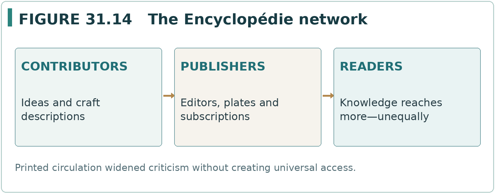

Denis Diderot and Jean le Rond d'Alembert helped lead the French <em>Encyclopédie</em>, published in major installments from 1751 into the early 1770s. It sought to bring together arts, crafts, philosophical debate, and technical descriptions. The plates of workshops and machines matter as much as the famous philosophical articles: they presented practical labor as knowledge worthy of systematic description.

The project faced censorship and political hostility. It relied on printers, engravers, editors, contributors, subscribers, and complicated business arrangements. Its contents did not express one consistent worldview. The encyclopedia was a meeting place for differing arguments, rather than a single manifesto agreed upon by everyone involved.

The parallel with earlier scientific journals is useful. Organizing knowledge can change who encounters it and who may challenge it. But access to a reference work did not equal universal literacy or political freedom. Most European subjects remained far from the privileged reading worlds in which such publications circulated.

<figure class="figure" id="figure-31-14">

<figcaption>Figure 31.14. Printed circulation widened criticism without creating universal access. <a class="figure-anchor" href="#figure-31-14" aria-label="Link to this figure">#</a></figcaption>
</figure>
