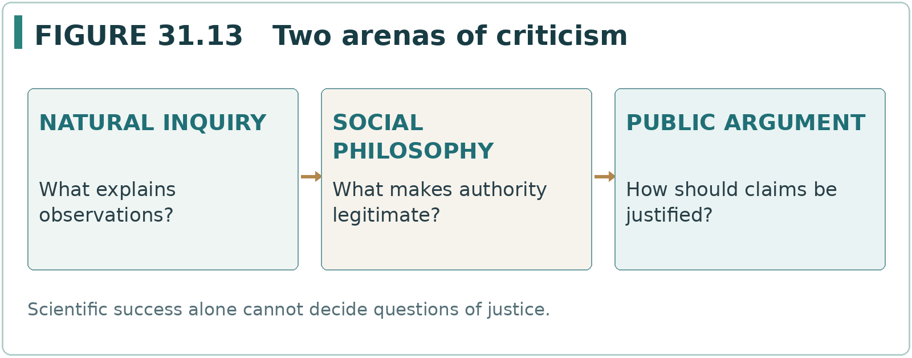

The Enlightenment did not simply mean that people discovered facts and then became democratic. Philosophers, writers, reformers, clergy, administrators, and critics developed different visions of human improvement during the long eighteenth century. Some hoped for constitutional government; others preferred a well-informed, reforming monarch. Some defended religious toleration; others attacked organized religion more aggressively. Many admired trade and education while disagreeing about inequality and empire.

Still, several themes linked the movements: confidence that institutions could be investigated, arguments about natural rights or human welfare, a growing reading public, and the claim that customary authority should justify itself. Enlightenment thinkers often looked to discoveries in physics as examples of human reasoning, but political societies cannot be studied exactly as falling stones. Moral values and competing interests enter every account of good government.

The chapter's central distinction is therefore between the ability to <em>explain</em> natural phenomena and the right to <em>decide</em> political arrangements. Scientific evidence may clarify the likely results of a policy; it does not alone decide what is fair. We must not silently turn scientific authority into moral authority.

<figure class="figure" id="figure-31-13">

<figcaption>Figure 31.13. Scientific success alone cannot decide questions of justice. <a class="figure-anchor" href="#figure-31-13" aria-label="Link to this figure">#</a></figcaption>
</figure>
