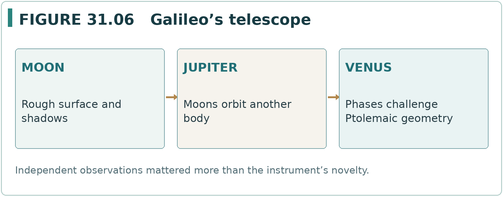

In 1609–10 Galileo Galilei improved the available telescope and pointed it toward the heavens. He observed a rugged lunar surface, numerous faint stars, four large satellites of Jupiter, and later the phases of Venus. These observations challenged widely accepted expectations. The Moon was not a flawlessly smooth sphere. Not every celestial object revolved directly around Earth. Venus showed a pattern of phases inconsistent with the standard Ptolemaic arrangement.

Yet caution matters. Venus's phases were compatible with more than one Sun-centered arrangement, including the Tychonic system with a stationary Earth. Galileo's telescope alone did not settle the whole cosmological debate. Optical quality, interpretation of what an unfamiliar instrument displayed, and access to repeated observations all mattered. Other astronomers had to learn to trust the device and reproduce the sightings.

Galileo also investigated falling bodies, inclined planes, motion, and mathematical regularities, contributing to new accounts of mechanics. His work was not a neat isolated series of experiments precisely matching every later retelling. The famous story of dropping unequal weights from Pisa's leaning tower is not a secure eyewitness account of a decisive experiment. What matters is the disciplined mathematical analysis of motion and its eventual role in later physics.

<figure class="figure" id="figure-31-6">

<figcaption>Figure 31.6. Independent observations mattered more than the instrument’s novelty. <a class="figure-anchor" href="#figure-31-6" aria-label="Link to this figure">#</a></figcaption>
</figure>
