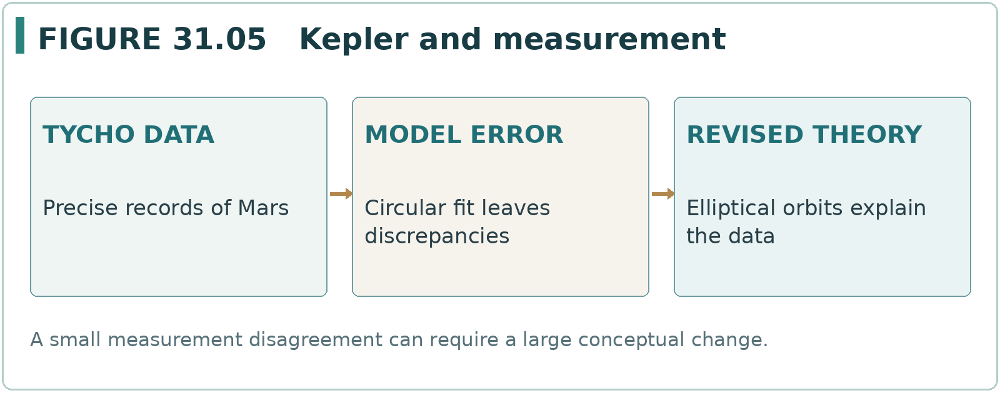

Johannes Kepler concluded that planets move on ellipses with the Sun at one focus, rather than on perfect circles. His three laws, formulated across works published between 1609 and 1619, described elliptical orbits, the sweeping of equal areas in equal times, and a mathematical relationship between orbital periods and distances. In simplified form, the third law says that the square of a planet's orbital period increases in proportion to the cube of the semi-major axis of its orbit around the Sun.

Kepler's achievement did not come from simply drawing a better picture. He wrestled with the mismatch between earlier models and Tycho's measurements, particularly the famous disagreement of roughly eight arcminutes for Mars. Rather than declare the discrepancy negligible, he treated it as evidence that the model had to change. Better measurements could require abandoning beautiful assumptions.

The laws were initially descriptions, not Newton's later explanation of the gravitational cause of the motions. Kepler also held speculative and religious beliefs that modern scientists would not adopt. This should not confuse us. People can produce durable knowledge while retaining other mistaken or untestable ideas. Judge each explanation by the work it actually performs.

<figure class="figure" id="figure-31-5">

<figcaption>Figure 31.5. A small measurement disagreement can require a large conceptual change. <a class="figure-anchor" href="#figure-31-5" aria-label="Link to this figure">#</a></figcaption>
</figure>
