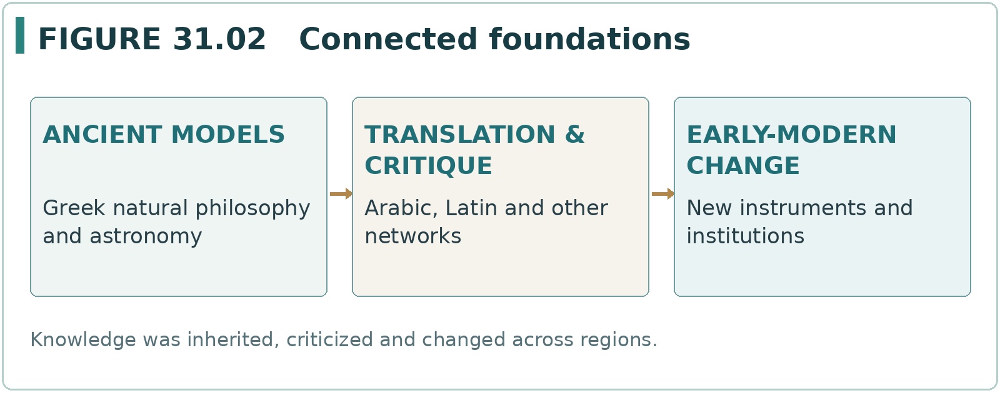

European universities inherited intellectual traditions combining Aristotle, Ptolemy, Hippocrates, Galen, Christian theology, and medieval commentary. Aristotle's works were not read as one simple, unchanging doctrine; teachers disputed interpretation and developed sophisticated questions about motion, causes, and evidence. Mathematical astronomy often used Ptolemaic models: deferents, epicycles, and other geometric devices for predicting the positions of celestial bodies. A complicated model could be effective at prediction even when its wider account of the universe proved incomplete.

Much of this learning had passed through Arabic scholarship, translation, and original investigation. Scholars including Ibn al-Haytham had developed influential work on optics, while astronomers in the Islamic world criticized and modified inherited planetary models. Indian mathematical traditions contributed important ideas to calculation; Chinese astronomers maintained extensive records of celestial phenomena and calendars. There were also local European traditions of navigation, metallurgy, architecture, medicine, and craft experimentation.

This does not mean every civilization followed one common scientific program. Their institutions, questions, tools, and forms of authority varied. The central historical point is that later European investigators worked within a long and connected inheritance. Innovation often meant rearranging or challenging knowledge already circulating, not replacing an intellectual void.

<figure class="figure" id="figure-31-2">

<figcaption>Figure 31.2. Knowledge was inherited, criticized and changed across regions. <a class="figure-anchor" href="#figure-31-2" aria-label="Link to this figure">#</a></figcaption>
</figure>
