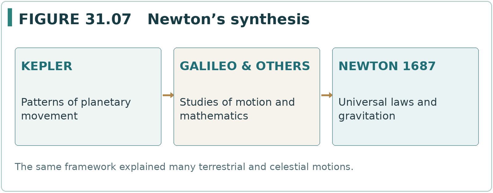

Isaac Newton's <em>Principia</em> (1687) brought together an account of motion and a universal law of gravitation. His laws described relationships among force, mass, and changes in motion; universal gravitation expressed an attraction between masses that varies inversely with the square of their separation. On a simplified idealization, doubling the distance between two point masses reduces the gravitational force between them to one quarter.

This mattered because the same mathematical framework could explain terrestrial falling motion and the orbits of celestial bodies. Kepler had described planetary patterns; Newton showed how an inverse-square gravitational force could produce such patterns under suitable conditions. The achievement was a synthesis of new methods, previous investigations, and difficult mathematics, not a solitary flash of inspiration.

Newton's framework was not a final theory of everything. Later researchers refined measurements and uncovered phenomena it could not fully explain; Einstein's general relativity eventually revised the account of gravitation at deeper scales. None of this means Newtonian physics was useless. A model can be extraordinarily accurate across a defined range and still be improved. That is one of science's deepest strengths.

<figure class="figure" id="figure-31-7">

<figcaption>Figure 31.7. The same framework explained many terrestrial and celestial motions. <a class="figure-anchor" href="#figure-31-7" aria-label="Link to this figure">#</a></figcaption>
</figure>
