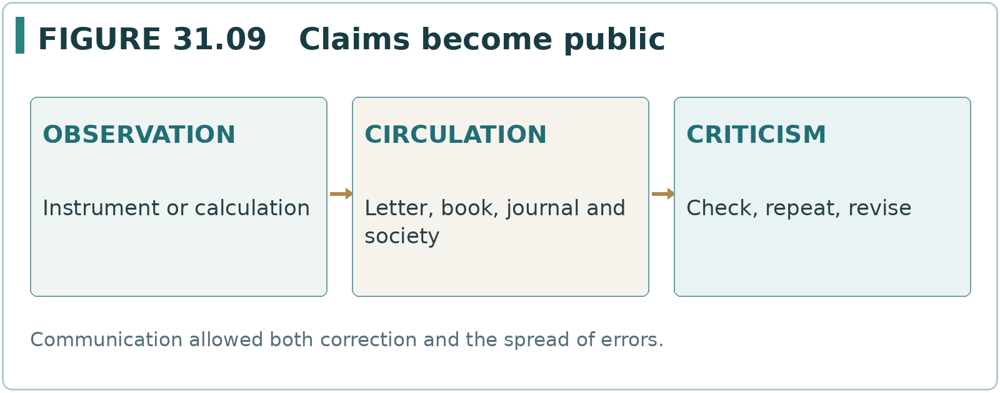

Early-modern scholars exchanged letters, books, instruments, and observations across borders. Networks later described as the 'republic of letters' linked people who were politically, linguistically, and religiously divided. Membership was uneven and elite. Correspondence could be delayed by war, censorship, distance, or poverty. Yet it allowed an astronomical observation in one city to be discussed elsewhere and a disputed experiment to be repeated.

Institutions gave these networks more durable forms. The Royal Society of London began in 1660 and received its royal charter in 1662. The Paris Académie royale des sciences was established in 1666. The <em>Philosophical Transactions</em> began publication in 1665 under Henry Oldenburg; it was an early model for scientific communication, though modern anonymous peer review did not appear fully formed at that moment.

These institutions built collective memory and a culture of public claims, but they also reflected social power. Wealth, patronage, language, gender, and religious standing affected participation. A printed article became evidence that a claim had been circulated; it did not automatically mean that the claim had been independently verified. The critical ideal was discussion and correction over time.

<figure class="figure" id="figure-31-9">

<figcaption>Figure 31.9. Communication allowed both correction and the spread of errors. <a class="figure-anchor" href="#figure-31-9" aria-label="Link to this figure">#</a></figcaption>
</figure>
