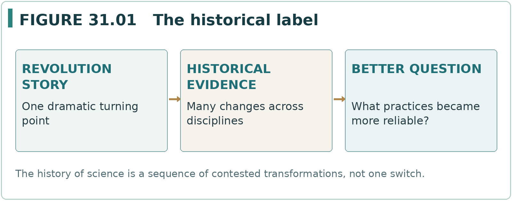

A revolution suggests a rapid overturning. Yet the transformations described in this chapter took place over generations and differed across disciplines. Astronomy changed in one sequence; anatomy and chemistry followed other paths. Many early-modern thinkers still accepted astrology, alchemy, biblical chronology, or ideas later abandoned. Newton studied theology and alchemy as well as mathematical physics. The people we call 'scientists' generally called themselves natural philosophers, mathematicians, physicians, or experimental practitioners.

Historians therefore argue about the usefulness and boundaries of the phrase <em>Scientific Revolution</em>. It highlights remarkable transformations, notably mathematical physics and experimental institutions, but it can falsely imply one inevitable path from medieval error to modern truth. It can also credit only a few European geniuses while overlooking earlier astronomy, mathematics, optics, and technical traditions from across Eurasia and Africa.

Our approach is to ask about changing practices rather than claim an abrupt victory of truth. What observations could people make? How did they argue? Who paid for instruments and books? Could a claim be tested independently? Why did some explanations convince more researchers than others? The same method should also govern our treatment of the Enlightenment: its aspiration to criticize inherited authority was real, but its claims to universality need testing against who was excluded.

<figure class="figure" id="figure-31-1">

<figcaption>Figure 31.1. The history of science is a sequence of contested transformations, not one switch. <a class="figure-anchor" href="#figure-31-1" aria-label="Link to this figure">#</a></figcaption>
</figure>
