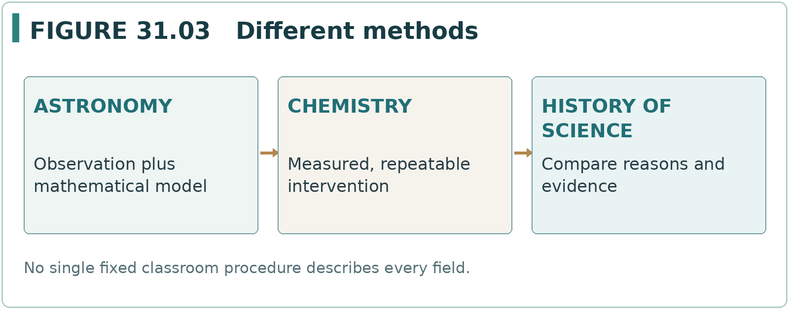

Modern textbooks may display a straight line: observation, hypothesis, experiment, conclusion. This can be a useful teaching framework, but it does not describe every important discovery. An astronomer cannot move Jupiter to another part of the sky to run a controlled experiment. A physician may compare patients and dissections. A chemist can weigh substances before and after reaction. A mathematician can prove a proposition without laboratory equipment. A historian of science must ask what kind of question was being answered.

Several changes became influential: systematic measurements, mathematical models, purposeful experiments, and public comparison of results. None ensured success. Bad instruments could produce precise-looking numbers; models might fit known observations but fail elsewhere; experimenters could interpret the same result differently. A new practice of criticism was as important as a new instrument. A claim had to survive objections about procedure, assumptions, and rival explanations.

An important distinction from Chapter 1 returns here. Observation does not speak by itself. Evidence gains meaning inside a question and a model. Early-modern investigators did not simply replace authority with the senses; they built new standards for arguing over what the senses and instruments were showing.

<figure class="figure" id="figure-31-3">

<figcaption>Figure 31.3. No single fixed classroom procedure describes every field. <a class="figure-anchor" href="#figure-31-3" aria-label="Link to this figure">#</a></figcaption>
</figure>
