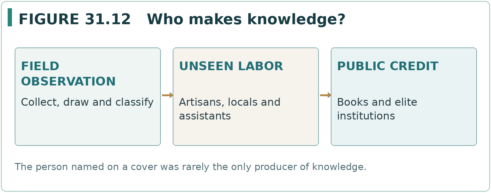

Women's opportunities to enter universities, learned societies, and high-status offices were heavily restricted, but women participated in scientific and philosophical work through correspondence, patronage, teaching, drawing, instrument use, household laboratories, and publication. Margaret Cavendish wrote works of natural philosophy and criticized aspects of experimental culture. Maria Sibylla Merian studied insect metamorphosis and worked with detailed botanical and entomological illustration, including research in Suriname.

Émilie du Châtelet contributed to the interpretation of Newtonian physics and wrote on physical theory and scientific explanation. Caroline Herschel's astronomical work became important in the late eighteenth century. These figures represent different contexts and kinds of achievement; they should not be reduced to a decorative list of exceptions to male intellectual history.

Their experiences also show that the boundaries of respectable knowledge were social choices. Someone able to observe or calculate could still be denied institutional status or access to a library. A credible history must track the work itself and also the barriers that shaped which work was preserved, printed, and remembered.

<figure class="figure" id="figure-31-12">

<figcaption>Figure 31.12. The person named on a cover was rarely the only producer of knowledge. <a class="figure-anchor" href="#figure-31-12" aria-label="Link to this figure">#</a></figcaption>
</figure>
