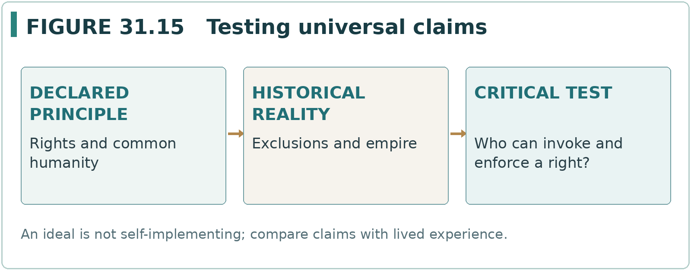

The language of universal reason and natural rights coexisted with exclusions based on gender, religion, legal status, and ideas of race. European states profited from colonial commerce and Atlantic slavery while some intellectuals defended the freedom of citizens. Many Enlightenment writers criticized slavery; others rationalized domination or failed to apply their principles consistently. The contradiction is part of the history, not an inconvenient footnote.

Thinkers including Mary Astell had earlier argued for women's education; later Mary Wollstonecraft demanded a radical reconsideration of women's status, most famously in <em>A Vindication of the Rights of Woman</em> (1792). Olympe de Gouges articulated demands for women's political equality during the French Revolution. African and Afro-descended writers and activists challenged slavery and racial hierarchy in their own voices. Olaudah Equiano's 1789 autobiography became influential in abolitionist debate, although historians continue to investigate aspects of his biography.

The critical intellectual move is to ask whether a principle's stated universality was matched by practice. That question is not a rejection of equality; it is a test of whether a society is willing to apply the logic of its own claims.

<figure class="figure" id="figure-31-15">

<figcaption>Figure 31.15. An ideal is not self-implementing; compare claims with lived experience. <a class="figure-anchor" href="#figure-31-15" aria-label="Link to this figure">#</a></figcaption>
</figure>
