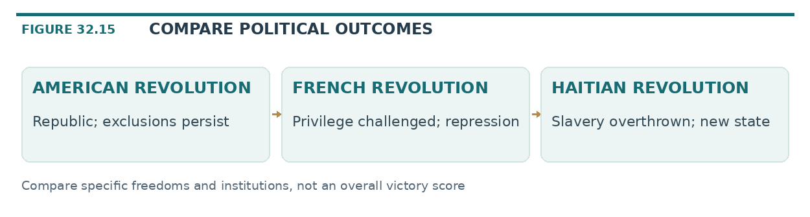

Consider three fictional people, constructed for teaching rather than based on individual historical lives. An artisan in Boston in 1787 can attend political meetings but may face property qualifications or other local voting restrictions. A Parisian market woman in 1791 can mobilize in demonstrations and publish arguments yet does not possess national electoral rights on the same terms as an eligible man. A worker in Saint-Domingue after abolition is no longer legally enslaved, but may face coercive agricultural regulations and limited ability to choose an employer or residence.

Which person is 'freest'? The question is too broad. We need to distinguish freedom from slavery, freedom of speech, political participation, freedom of movement, security of property, and equality before courts. The answers may differ by dimension. This is a powerful reason to study citizenship as a bundle of specific capacities and protections rather than a simple label assigned to a society.

<figure class="figure" id="figure-32-15">

<figcaption>Figure 32.15. Compare specific freedoms and institutions, not an overall victory score. <a class="figure-anchor" href="#figure-32-15" aria-label="Link to this figure">#</a></figcaption>
</figure>

Now imagine evaluating a fourth person: a Native political leader negotiating with the early United States. A republic may treat his nation as a treaty-making counterpart in one setting and seek to curtail its territory in another. Citizenship in a state and political autonomy of a distinct people are not the same question. Definitions that work for a property-owning settler may fail to explain Indigenous sovereignty. Comparison is most valuable when it reveals such boundaries instead of concealing them.
